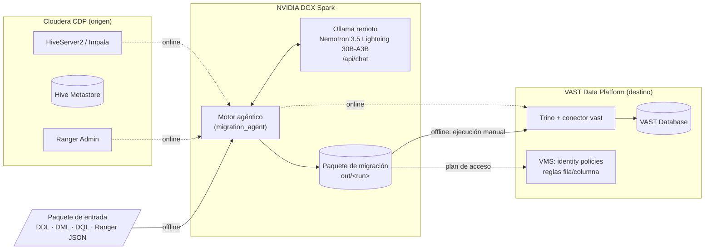
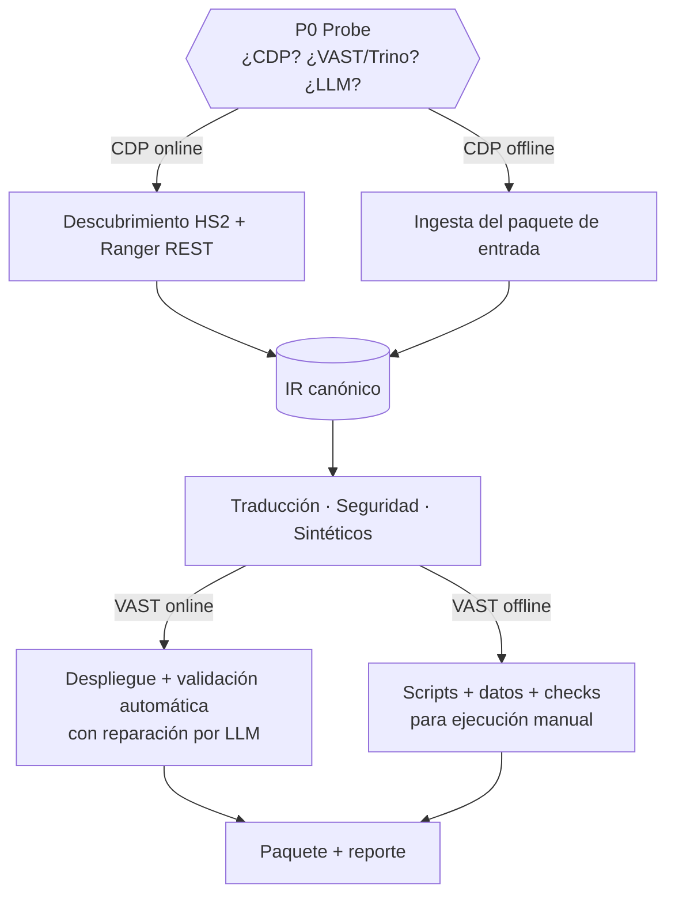
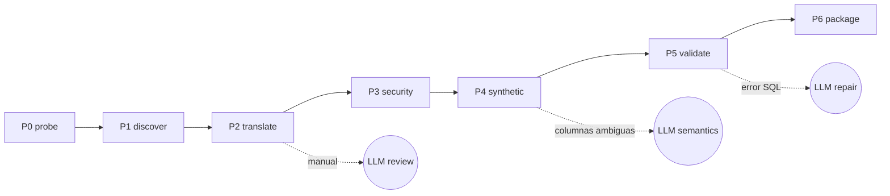

# Arquitectura del motor agéntico de migración Cloudera CDP → VAST Database

> Versión 0.1 · noviembre 2026 · LLM: Nemotron 3.5 Lightning 30B-A3B vía Ollama (DGX Spark) · Destino: VAST Database 5.5 vía Trino

## 1. Objetivo y restricciones

Automatizar la migración de objetos y lógica SQL de **Cloudera CDP** (Hive, Impala, HDFS y Ranger) hacia
**VAST Database**. El motor se ejecuta en una **DGX Spark** y debe funcionar en cualquiera de estas condiciones:

| # | Restricción | Cómo la resuelve el diseño |
|---|---|---|
| R1 | La DGX puede **no** tener acceso a CDP | **Modo origen offline**: recibe DDL, DML, DQL y políticas Ranger exportadas (paquete de entrada) y las interpreta con el mismo parser que el modo online |
| R2 | La DGX puede **no** tener acceso a VAST | **Modo destino offline**: genera los scripts equivalentes para VAST con la **matriz de equivalencia** basada en la documentación oficial, más datos sintéticos y validaciones para ejecución manual |
| R3 | La integración con VAST es por el **cliente Trino** | Todo el SQL de salida es dialecto Trino con nombres `vast."<bucket>/<schema>".<tabla>`; el despliegue online usa el cliente Python `trino` |
| R4 | Tools y skills por fase, incluida la generación de datos sintéticos | 7 fases, cada una con su `SKILL.md` y sus tools determinísticas; la skill de datos sintéticos adapta el patrón *faker-data-generation* de Databricks |

## 2. Principios de diseño

1. **Determinístico primero, LLM después.** Reglas (matriz YAML + `sqlglot`) resuelven la mayor parte de
   la traducción. El LLM (Nemotron vía Ollama) solo interviene en lo que queda como `manual`, para clasificar columnas
   ambiguas y para reparar sentencias que fallan en VAST. **El motor produce un resultado válido sin LLM**
   (`--no-llm`), algo necesario con modelos locales chicos y en ambientes sin GPU.
2. **Humano en el bucle.** Las propuestas del LLM se validan sintácticamente y van a `review/`; nunca se
   mezclan solas con los scripts principales. El motor no modifica VMS ni ejecuta DML de negocio.
3. **Un solo camino de traducción.** Online y offline convergen en la misma representación intermedia (IR).
4. **Trazabilidad.** Cada decisión es un `Finding` con severidad, regla de la matriz, objeto, si la regla
   está **verificada** contra la doc VAST y quién la resolvió (`rule` | `llm` | `human`).
5. **Paquete autocontenido.** La salida se puede copiar a un servidor con acceso a VAST y ejecutar
   solo con el cliente Trino.

## 3. Vista de contexto



## 4. Matriz de modos



| Origen \ Destino | VAST online | VAST offline |
|---|---|---|
| **CDP online** | Descubre, traduce, despliega, carga y valida (conteos del origen real) | Descubre y traduce; entrega scripts y datos para ejecución manual |
| **CDP offline** | Interpreta los scripts de entrada; despliega y valida con datos sintéticos | Interpreta los scripts de entrada; entrega scripts, datos sintéticos y checks para ejecución manual |

## 5. Fases, tools y skills



| Fase | Skill (`skills/`) | Tools determinísticas | Uso del LLM | Artefactos |
|---|---|---|---|---|
| **P0 Probe** | `00-connectivity-probe` | `tcp_probe`, `probe_hive`, `probe_trino`, `create_llm().available` | — | `report.json → modes` |
| **P1 Discover** | `01-source-discovery` | `source_online.discover` (SHOW CREATE TABLE, conteos, Ranger REST) · `source_offline.ingest_bundle` · `split_statements` · `classify` · `table_from_ddl` · `parse_ranger_export` | — | Inventario (IR) |
| **P2 Translate** | `02-vast-sql-translation` (+ `references/equivalence-matrix.md`) | `EquivalenceMatrix.map_type` · `Translator.translate_table/statement` · `_fix_implicit_casts` · `strip_impala_hints` | Propuesta JSON para sentencias `manual`, validada con `validate_trino_syntax` | `01_ddl/`, `02_dml/`, `03_dql/`, `review/llm_suggestions.sql` |
| **P3 Security** | `03-ranger-policy-mapping` | `ranger.translate_policies` (access/deny → identity policy; column → allow/deny; masking → column mask; rowfilter → row filter) | — (la seguridad no se delega al LLM) | `04_security/vast_access_plan.json`, `trino_rules.json`, `vast_catalog_security.properties` |
| **P4 Synthetic** | `04-synthetic-data-generation` (+ `references/providers-and-corruption.md`) | `SyntheticGenerator` · `infer_semantic` · `write_outputs` · `render_inserts` | Clasifica columnas ambiguas dentro de una lista cerrada de semánticas | `05_synthetic/<db>/<tabla>/{parquet, insert.sql}`, `manifest.json` |
| **P5 Validate** | `05-vast-deploy-validate` | `TrinoTarget.execute` · `build_checks` · `compare` | Repara sentencias que fallan en VAST (máximo N intentos) | `06_validation/{checks.sql, expected_results.json, results.json}` |
| **P6 Package** | `06-migration-packaging` | `p6_package` | — | `RUNBOOK.md`, `00_report/`, `review/manual_items.md` |

Las skills usan **divulgación progresiva**: el orquestador inyecta el `SKILL.md` de la fase activa en el
prompt del LLM, y las referencias se cargan bajo demanda con la tool `read_skill`.

## 6. Componentes

```
migration_agent/
  core/
    ir.py          IR: Table, Column, Statement, RangerPolicy, Finding, Inventory
    matrix.py      Matriz de equivalencia (config/equivalence_matrix.yaml)
    config.py      YAML + ${VAR:-default}
    llm.py         Clientes LLM sin dependencias: OllamaClient (/api/chat, num_ctx, think, keep_alive)
                   y OpenAICompatClient (NIM/vLLM); tool calling normalizado a formato OpenAI
    skills.py      Registro de skills (frontmatter YAML + referencias)
  tools/           Tools determinísticas por fase (ver tabla §5)
  agent/
    pipeline.py    Orquestador (máquina de estados P0..P6, enrutamiento por conectividad)
    tools_registry.py  Tools expuestas al LLM (formato OpenAI "tools")
    react.py       Modo agente interactivo (ReAct + tool calling sobre Ollama/Nemotron)
  cli.py           probe | run | translate | ask
skills/            SKILL.md por fase
config/            agent.yaml (VAST), agent.local.yaml (emulación Iceberg), equivalence_matrix.yaml
```

### 6.1 Orquestación
El pipeline es una **máquina de estados explícita**, no un agente libre: las fases tienen un orden
fijo y el LLM interviene en puntos acotados con salidas JSON validables. Así el proceso es reproducible
y auditable, y funciona con modelos de 8–12B parámetros en la DGX Spark. El modo `ask` ofrece además un
**agente ReAct** para tareas puntuales en lenguaje natural ("traduce esta consulta", "¿qué columnas
requieren revisión?"). Usa las mismas tools, y solo las de lectura sobre VAST.

> La interfaz de las fases (`RunContext` → artefactos) permite migrar el orquestador a LangGraph si se
> necesita persistencia de checkpoints o interrupciones humanas por nodo. Cada fase pasa a ser un nodo y
> cada condición de conectividad una arista condicional.

### 6.2 Contrato LLM
| Nodo | Entrada | Salida (JSON) | Validación |
|---|---|---|---|
| Revisión de traducción | SQL origen + hallazgos + SKILL.md de traducción | `{"sql": [...], "explanation", "confidence"}` | `sqlglot.parse(read="trino")`; queda en `review/` |
| Semántica de columnas | Columnas ambiguas + lista cerrada | `{"columns": {col: semántica}}` | Solo valores de la lista |
| Reparación (online) | SQL + error de VAST + SKILL.md de despliegue | `{"sql": "..."}` | Se re-ejecuta; si funciona se registra `deploy.llm_repaired` |

Degradación: si el LLM no responde (u Ollama no tiene el modelo descargado), el motor registra `llm.unavailable` y continúa en modo determinístico.

### 6.3 Modelo y proveedor LLM
| Parámetro | Valor por defecto | Motivo |
|---|---|---|
| `llm.provider` | `ollama` | API nativa `/api/chat`: permite `num_ctx`, `think` y `keep_alive` por petición |
| `llm.model` | `nemotron-3.5-lightning:30b-a3b` | MoE de 30B con 3B activos: rápido para muchas llamadas cortas con tool calling. En la DGX Spark también `:30b-a3b-nvfp4` (NVFP4 nativo de Blackwell, ~23 GB) |
| `llm.num_ctx` | 32768 | Ollama usa 4096 por defecto: no alcanza para SKILL.md + DDL + hallazgos |
| `llm.think` | `false` | Las salidas son JSON acotado; razonar agrega latencia. Se puede subir a `true/low/medium/high` para la revisión de sentencias complejas |
| `llm.keep_alive` | `30m` | Mantiene el modelo cargado entre fases |

Alternativa: `provider: openai` con NVIDIA NIM, vLLM o el endpoint `/v1` de Ollama (`docker/nim/`).

## 7. Matriz de equivalencia (resumen)

Fuente ejecutable: [`config/equivalence_matrix.yaml`](../config/equivalence_matrix.yaml). Versión legible:
[`skills/02-vast-sql-translation/references/equivalence-matrix.md`](../skills/02-vast-sql-translation/references/equivalence-matrix.md).
Basada en VAST Cluster 5.5 (SQL reference, data types, Trino integration, limits).

Decisiones principales:
- **Nombres:** `vast."<bucket>/<schema>".<tabla>`; cada base Hive pasa a ser un schema dentro de un bucket.
- **Tipos:** `STRING→VARCHAR`, `TIMESTAMP→TIMESTAMP(6)`, complejos `ARRAY/MAP/ROW`. `UNIONTYPE` e `INTERVAL` quedan como manual.
- **Particiones:** columnas normales más `WITH (partitioning = ARRAY[...])`, con máximo 4 llaves, solo al crear la tabla. Los buckets pasan a ser `bucket(col, n)`.
- **Orden:** `sorted_by` (máximo 4 columnas, inmutable). Si la tabla está particionada, va dentro del `CREATE`.
- **DML:** `INSERT OVERWRITE` se convierte en `DELETE + INSERT` dentro de una transacción. `LOAD DATA` y `UPSERT` quedan como manual. `TRUNCATE` se convierte en `DELETE`.
- **Tipado estricto:** Trino no convierte tipos implícitamente; el traductor vuelve explícitas las comparaciones entre columnas tipadas y literales.
- **Seguridad:** sin GRANT/REVOKE. Se usan identity policies y reglas fila/columna de VAST aplicadas por Trino (`enable_access_control`, `enable_row_column_security`, `enable_end_user_impersonation`).

Cada regla lleva `verified: true|false` para distinguir lo confirmado en la doc VAST de lo inferido de
Trino estándar. Las reglas `false` se deben confirmar en el primer despliegue online.

## 8. Generación de datos sintéticos

Adaptación del patrón Databricks *faker-data-generation* a un esquema desconocido de antemano:

| Patrón Databricks | Implementación aquí |
|---|---|
| Semilla única (numpy + Faker) | `synthetic.seed` para `random` y `Faker.seed_instance` |
| Distribuciones no uniformes | Zipf para categorías, log-normal para montos, Poisson para contadores, estacionalidad semanal |
| Dimensiones antes que hechos + FKs ponderadas | `order()` genera padres primero; `relationships` con `weights` |
| Coherencia por fila | Fecha = fecha del evento; semana y mes derivados; auditoría > evento; correo derivado del nombre |
| Corrupción configurable mapeada a expectations | `corruption_rate` y `manifest.corruptions[]` con la validación que debe fallar |
| Solo datos crudos | Sin agregados |
| Validación impresa al final | `manifest.expected` → checks de P5 |
| *(nuevo)* Esquema desconocido | `infer_semantic` por nombre y tipo, más LLM con lista cerrada |
| *(nuevo)* Destino VAST | Parquet con tipos VAST e `INSERT` Trino en lotes de menos de 5 MB |

## 9. Seguridad y operación

- Credenciales solo por variables de entorno (`RANGER_PASSWORD`, `LLM_API_KEY`, claves VAST en el catálogo Trino); nunca se escriben en reportes.
- El modo agente expone a VAST solo consultas de lectura. El DDL lo ejecuta el pipeline, no el LLM.
- El LLM corre **local** en la DGX (Ollama), así que los DDL, las políticas y los metadatos no salen del perímetro.
- El plan de acceso VAST es una especificación para revisión: el motor no toca VMS.

## 10. Despliegue en la DGX Spark

```bash
# En la DGX: OLLAMA_HOST=0.0.0.0:11434 ollama serve ; ollama pull nemotron-3.5-lightning:30b-a3b
make ollama-check    # LLM_BASE_URL / LLM_MODEL en .env
make agent-probe     # verifica CDP / Trino-VAST / LLM
make agent-run       # pipeline (auto online/offline)
make agent-run-offline INPUT_BUNDLE_HOST=/ruta/al/paquete   # sin CDP ni VAST
```

Emulación local de punta a punta (Hive en Docker → Trino/Iceberg en Docker): `make agent-run-local`.

## 11. Riesgos y siguientes pasos

| Riesgo | Mitigación |
|---|---|
| Reglas `verified: false` (VARCHAR(n), CHAR, sorted_by en `WITH`, TRUNCATE, MERGE) | Confirmar en el primer despliegue online; actualizar la matriz |
| Modelos chicos producen JSON inválido | `extract_json` tolerante, reintento sin `response_format`, validación sintáctica, y el modo determinístico como piso |
| Migración de **datos reales** (no sintéticos) | Siguiente iteración: estrategia federada `INSERT INTO vast... SELECT FROM hive...` (catálogo `hive` en Trino) o exportación de Parquet e importación con `vast.import_data` |
| UDFs Hive/Java | Quedan como manual con propuesta del LLM; catálogo de UDFs frecuentes como trabajo futuro |
